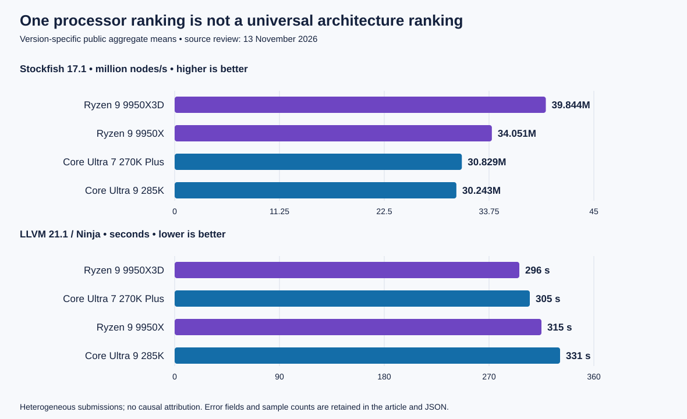

# Why Wider Apple Cores Can Lose at Stockfish

## M4 Max and M5 Max versus Zen 5 and Arrow Lake

**Ryzen 9 9950X3D · Ryzen 9 9950X · Core Ultra 7 270K Plus · Core Ultra 9 285K**  
**PassMark case study: M5 Pro, specifically the 18-core model, using individual reported results.**  
Originating architectural analysis: **Peter Kosanyi** · Research synthesis: **OpenAI Codex**  
Evidence reviewed: **13 November 2026** · Method: public-result audit, source-code analysis, and explicit throughput models

> **The central finding:** a wider scalar front end and more general integer ALUs do not require an Apple CPU to win Stockfish. Modern Stockfish combines irregular chess search with quantized integer neural-network evaluation. Its useful work per cycle depends on instruction-specific vector kernels, bitboard indexing, cache locality, sustained clocks, and parallel utilization.

This is a research review, not a new hardware benchmark campaign. Public averages, individual submissions, contributor-derived architecture results, and conditional calculations retain distinct labels. No ARM-versus-x86 performance ranking uses PassMark or NovaBench.

### Read the article

1. [The architectural question](#1-the-architectural-question)
2. [Verified Stockfish results](#2-verified-stockfish-results)
3. [Exclusive architectural analysis](#3-exclusive-architectural-analysis)
4. [Why Stockfish can favor Zen 5](#4-why-stockfish-can-favor-zen-5)
5. [M5 Pro 18-core: individual PassMark results](#5-m5-pro-18-core-individual-passmark-results)
6. [LLVM compilation](#6-llvm-compilation)
7. [Experiments that distinguish the causes](#7-experiments-that-distinguish-the-causes)
8. [Findings and limits](#8-findings-and-limits)
9. [Sources and reproduction](#9-sources-and-reproduction)

## 1. The architectural question

The question is why a Zen 5 desktop can search more Stockfish nodes per second than an Apple Max SoC with wider scalar machinery and unusually large out-of-order resources. A second workload, LLVM compilation, tests whether the same resource balance produces a different ordering.

The intended AMD models are **9950X3D and 9950X**, correcting the shortened spoken names in the originating question. The Intel comparison is **270K Plus**; 285K is retained for context. Full M4 Max combines twelve performance and four efficiency cores. M5 Max and the full 18-core M5 Pro combine **six super cores and twelve new performance cores**. Apple's release identifies these twelve as a new design; they cannot be characterized by simply copying the base M5 E-core measurements. [A5]

### The originating benchmark-derived findings

Peter's calculations are part of the research record. The table preserves them and identifies where independently retrieved measurements use another definition or differ. This is a provenance audit, not a characterization of the originating work as imaginary.

| Feature | Originating finding or estimate | Independent evidence and treatment |
|---|---|---|
| M4 large-core front end | Ten-wide decode; about fourteen to fifteen micro-ops/cycle supplied from L1 | Ten-wide sustained throughput is supported. A measured sixteen-instruction/cycle fetch rate is a different quantity. |
| M4 large-core execution | Eight integer ALUs and four FP pipelines | Corroborated at the instruction-class level; eligible ports differ by operation. |
| M4 instruction window | More than 800, approximately 900 ROB entries | Preserved as the originating estimate; published probing reports approximately 3,184 NOPs or 313 coalesced groups, not directly comparable conventional entries. |
| M4 efficiency core | Four ALUs, seven-wide front end, more than 700 entries | Four ALUs is corroborated. Retrieved M4 measurements show five-wide sustained throughput and approximately 513 NOPs in flight. |
| M5 super core | Approximately eleven-wide decode, sixteen micro-ops/cycle from L1, eight ALUs, eight 128-bit FP paths, 1,000-plus window | Preserved as the contributor's reconstruction; retrieved base-M5 instruction tests instead report ten NOPs/cycle and four FP/SIMD units. |
| M5 new performance core | Seven-wide, eight ALUs, four FP paths, 700-plus window | Preserved explicitly. Apple confirms the new core type but does not publish this complete port/window specification. |
| M5 branch prediction | Very large BTB, potentially larger than Zen 5 | A comparable capacity and prediction-quality ranking is not established here. |
| ILP/IPC | Approximately forty to seventy percent advantage | Replaced with operation-specific calculations below, rather than an unsupported universal percentage. |

M4 source: Jiajie Chen's direct experiments. Base-M5 source: the open m5-uarch instruction study, which documents packing and measurement limits. Neither is a new M5 Pro/Max secondary-core measurement performed by this article. [M4, M5U]

Large L1/L2 caches, low access latency, and deep windows remain substantive architectural advantages. The issue is how each resource translates into useful work in a particular program.

## 2. Verified Stockfish results

### Stockfish 17.1 / Chess Benchmark

| Processor | Cores / hardware threads | Nodes/s | Million nodes/s | Published ± field | Compatible public results |
|---|---:|---:|---:|---:|---:|
| Ryzen 9 9950X3D | 16 / 32 | 39,844,461 | **39.844** | 1,999,706 | 51 |
| Ryzen 9 9950X | 16 / 32 | 34,051,313 | **34.051** | 2,301,117 | 43 |
| Core Ultra 7 270K Plus | 24 / 24 | 30,829,082 | **30.829** | 1,319,269 | 10 |
| Core Ultra 9 285K | 24 / 24 | 30,242,620 | **30.243** | 454,953 | 21 |

Source: version-specific OpenBenchmarking aggregate, retrieved with a reported data cutoff of 22 October 2026. These are heterogeneous public submission averages, not four matched machines. The ± field is transcribed without calling it a confidence interval, and compatible-result counts are not counts of independently controlled systems. [S17]

| Calculated comparison | Throughput ratio | Advantage |
|---|---:|---:|
| 9950X3D / 9950X | 1.170× | 17.0% |
| 9950X3D / 270K Plus | 1.292× | 29.2% |
| 9950X3D / 285K | 1.317× | 31.7% |
| 270K Plus / 285K | 1.019× | 1.9% |

The remembered 3.8 million nodes/s for the Ryzen does not match this result's magnitude: it is approximately forty million. The remembered 1.7 million for M4 Max lacks a recoverable engine version, thread count, network, and position suite, so it is not silently changed to seventeen million or used as a verified denominator.

### Apple measurement coverage

| Requested processor | Located public run | Accepted matched numeric result |
|---|---|---|
| M4 Max, sixteen cores | Native macOS result 2605173-NE-APPLEM4MA20 | Not recovered from the accessible chart/text |
| M5 Max, eighteen cores | Native macOS result 2606146-NE-STOCKFISH18 | Not recovered from the accessible chart/text |

Those records establish identifiable submissions, not an exact Apple-to-Ryzen throughput ratio. The article explains supported mechanisms; it does not pretend to have measured their individual contribution to an unverified gap. [AM4, AM5]

Version matching is essential. The retrieved Stockfish 17 Phoronix install recipe uses `bench 4096 $NUM_CPU_CORES 26`; the profile history states that 17.1 switches to the built-in `speedtest`. Engine/network changes and different benchmark procedures preclude pooling their NPS figures. [PTS17, PTSREV, SFBENCH]

*The panels show separate workloads and units. They exclude unverified Apple scores and all PassMark data.*

## 3. Exclusive architectural analysis

This section describes resources and theoretical ceilings. It is separate from measured application performance and makes no performance-per-watt ranking.

### 3.1 What width actually measures

| Stage | Width describes | Important distinction |
|---|---|---|
| Fetch | Encoded bytes or instructions read per cycle | Instructions still need interpretation and downstream capacity |
| Decode | Architectural instructions converted into internal operations | Complex operations can expand; some pairs fuse |
| Op-cache delivery | Previously decoded operations supplied per cycle | Separate from an ordinary L1 instruction-cache hit |
| Rename/dispatch | Work admitted to the out-of-order machine | Can be narrower than aggregate execution-port capacity |
| Issue | Ready operations sent to eligible units | Dependencies and operation-specific ports apply |
| Retirement | Correct-path completed work committed | Older stalls and speculation affect progress |

AArch64's fixed-width encoding simplifies instruction boundaries; it **does not remove decoding on an L1I hit**. Fetching sixteen instructions/cycle does not establish sixteen sustained retired instructions/cycle. Likewise, summing all execution ports is not a measurement of decoder throughput. Queues can sustain temporary bursts, not an indefinite mismatch between admission and consumption.

AMD specifies Zen 5 with two four-wide decode paths, an approximately 6K-entry op cache, eight-wide dispatch, six integer ALUs, and a 448-entry single-thread window. The FP/vector engine has four arithmetic pipelines, including two FMA-capable paths. Its op cache makes a decoder-only comparison incomplete. [Z5, ZDEC]

### 3.2 Operation-specific resources

| Resource | M4 large core | Zen 5 desktop | M5 super core | Lion Cove / Skymont |
|---|---|---|---|---|
| General scalar integer ALUs | 8 | 6 | 8 in retrieved base-M5 tests | 6 / 8 |
| Front-end reference | Ten-wide sustained suitable streams | Eight-wide dispatch; decode/op-cache limits differ | Ten NOPs/cycle in base-M5 tests; originating reconstruction is eleven-wide | Eight-wide Lion Cove; Skymont 3×3 decode and eight-wide allocation |
| Vector arithmetic relevant here | 128-bit NEON | Native 512-bit desktop AVX-512 | 128-bit NEON; originating reconstruction is eight FP paths | 256-bit AVX2 exposure; Skymont has 128-bit execution resources |
| Hardware contexts/core | 1 | 2 with SMT | 1 | 1 / 1 |

Sources: M4, M5U, Z5, LC, SKY, I270. Intel architecture descriptions are design context rather than a full new 270K Plus die measurement. A basic ALU count says nothing by itself about multiply, shifts, flags, population count, PEXT, vector integer arithmetic, or branches. Each can have different throughput, latency and eligible ports.

### 3.3 Calculate the integer advantage

For independent basic arithmetic, a deliberately simplified upper bound is:

$$Q_{int} \leq \sum_i C_i f_i\min(A_i,F_i)$$

Here C is core count, f is sustained clock, A is eligible ALUs and F is sustained admission for the selected instruction stream. Dependencies, memory and shared limits are omitted; this is not a Stockfish predictor.

| Calculation | Advantage | Interpretation |
|---|---:|---|
| 8 / 6 | **33.3%** | Eligible scalar integer width/core at equal clock |
| 10 / 8 | **25.0%** | Compatible stage-width ratio |
| Supplied 11 / 8 | **37.5%** | Conditional stage-width ratio |
| M4 Max: (12×8 + 4×4) / (16×6) | **16.7%** | Nominal package ALU count at one artificial common clock |
| Supplied M5: (6×8 + 12×8) / (16×6) | **50.0%** | Nominal package ALU-count advantage |
| M5 with a sustained seven-instruction secondary-core limit: (6×8 + 12×7) / (16×6) | **37.5%** | Front-end-constrained pure-ALU ceiling |
| Intel nominal count: (8×6 + 16×8) / (16×6) | **83.3%** | Demonstrates why package ALU count alone does not predict Stockfish |

Peter's fifty-percent estimate has a concrete mathematical interpretation under the supplied core counts. It is not a measured universal IPC lead. Do not multiply the thirty-three-percent ALU ratio by the twenty-five-percent front-end ratio: they constrain the same work flow.

ILP is independent work available in a program; hardware width and window depth affect how much can be exploited. Cross-ISA IPC additionally depends on instructions per completed task. A more expressive instruction can reduce the instruction count and improve completion time while producing lower measured IPC.

### 3.4 Scalar FP versus packed FP

Assume enough independent accumulators and one FMA start/cycle on every counted path. Count an FMA as two FLOPs.

| Per-core ceiling | M4: four 128-bit paths | Zen 5: two 512-bit FMA paths | Supplied M5: eight 128-bit paths |
|---|---:|---:|---:|
| Independent scalar FMAs/cycle | 4 | 2 | 8 |
| Scalar FLOPs/cycle | 8 | 4 | 16 |
| Packed FP32 FLOPs/cycle | 32 | 64 | 64 |
| Packed FP64 FLOPs/cycle | 16 | 32 | 32 |

Eight eligible M5 paths would imply four times Zen 5's scalar FMA instruction rate but equal packed FP32 FMA lane throughput/cycle, before clocks. Two FMA paths do not mean Zen 5 can execute only two arbitrary scalar FP operations: operation mix and port eligibility matter. Stockfish's quantized evaluation is integer arithmetic, so FP32 FMA ceilings do not settle its ranking.

**Units:** 128 bits equals sixteen bytes. Eight 128-bit paths total 1,024 bits. Writing eight times 128 **bytes** would overstate that width eightfold.

### 3.5 Windows, caches and prediction

A deep window can overlap independent operations beyond a stall. It cannot manufacture independence in a chain of state load, move determination, position update and child search. Wrong-path work can consume the resources without helping retirement.

Apple's coalesced groups make NOP capacity, physical group count and mixed-program capacity different measurements. A value near nine hundred from one experiment is not a universal conversion into Zen ROB entries.

| Cache dimension | M4 large / efficiency core | Zen 5 desktop core |
|---|---|---|
| L1 instruction capacity | 192 / 128 KiB | 32 KiB |
| L1 data capacity | 128 / 64 KiB | 48 KiB |
| L2 reference | Large cluster-shared cache; the measured M4 P cluster reports 16 MiB | Private 1 MiB per core |

Sources: M4, Z5. Family-level shared-cache measurements retain their scope rather than being relabeled as a per-core allocation. Cache capacity, sharing scope, hit latency in cycles and hit latency in nanoseconds require separate treatment. For example, three cycles at 4.5 GHz is 0.667 ns, versus four at 5.5 GHz being 0.727 ns. Those are illustrative inputs, not matched measured cache results. A shared cluster L2 is not interchangeable with a private per-core L2, and an SoC system cache is not identical to CPU LLC.

Likewise, BTB capacity does not establish conditional-branch direction accuracy. Target lookup, branch history, aliasing, taken-branch delivery and recovery latency all matter. No unsupported Apple-versus-Zen BTB ranking is required to explain the workload.

## 4. Why Stockfish can favor Zen 5

### 4.1 Integer-heavy includes neural SIMD

| Component | Representative work | Important resources |
|---|---|---|
| Search/move generation | Bitboards, attack indices, legality, state, cutoffs, hash probes | Scalar operations, specialized bit instructions, branches, load latency and locality |
| NNUE evaluation | Incremental accumulators, clipping, affine layers, reductions | Packed integer arithmetic, dot products, vector loads, register bandwidth |

The tagged affine-layer source uses unsigned byte inputs, signed byte weights and 32-bit outputs. The SIMD helpers expose x86 dot-product intrinsics and ARM `vdotq_s32`; the Apple-silicon build target enables NEON dot-product support. Thus integer-heavy does not mean dominated by general scalar ALUs. [SFAFF, SFSIMD, SFMAKE]

A 512-bit byte-dot instruction processes four times the vector width of a 128-bit instruction. That is a width ratio, not a fourfold application speedup. Eligible issue rates, signedness handling, sparsity, reduction work and loads affect the kernel; scalar search remains around it.

Architecture-specific implementations can perform the same evaluation with different instruction counts. A native Zen VNNI512 binary and a native Apple NEON-dot binary need not do identical machine work. An inappropriate build target can harm either platform.

### 4.2 PEXT changes the scalar instruction sequence

Stockfish's `Magic::index()` explicitly selects PEXT when enabled and uses a magic-bitboard indexing alternative otherwise. PEXT gathers selected occupancy bits directly into an attack-table index; the alternative uses masking, multiplication and shifting. The same chess operation therefore has different machine sequences. [SFBIT]

Six versus eight general ALUs does not capture that difference. Nor does the source alone prove a fixed benefit: measure PEXT enabled/disabled while controlling the binary's other instruction paths and profiling move generation.

### 4.3 V-Cache changes time lost to memory

Stockfish accesses transposition-table buckets, NNUE data and per-worker state. More cache can preserve reused data even when the full hash allocation is much larger than LLC. The proper question is how misses and stalled cycles change, not whether an entire multi-gigabyte allocation fits on chip.

The 9950X3D has 128 MB total L3, versus 64 MB for 9950X. Their 17.0% aggregate NPS difference holds generation and core/thread counts constant, making it informative, but clocks, memory, firmware and submitted systems still differ. It is not a cache-only causal measurement. Placement matters because total package cache is not uniformly local to every core. [D3D, D9950]

### 4.4 SMT improves utilization

Two hardware contexts share a Zen core. When one waits on a dependency or miss, its sibling can provide ready work. SMT does not duplicate the ALUs or guarantee a fixed multiplier. Its contribution needs sixteen-versus-thirty-two-worker measurements on the same Ryzen, with placement and effective clocks recorded.

Parallel search also changes the tree explored. More NPS is not automatically the same percentage of stronger chess, less time to solve, or greater search efficiency. Keep node count, wall time and search limits alongside NPS.

### 4.5 The Intel result is coherent

The 270K Plus has eight P and sixteen E cores without Hyper-Threading. It exposes AVX2 rather than desktop AVX-512. Its strong nominal integer resources coexist with a different NNUE kernel path, cache/memory system and balance of core types. Lower Stockfish NPS does not establish a generally weak integer microarchitecture. [I270]

The refresh also changes memory support and the die-to-die link frequency; it is not a new universal core-width multiplier over 285K. [IREF]

### 4.6 Useful work is the accounting unit

$$NPS = \frac{instructions/second}{instructions/node}$$

For a heterogeneous processor, instructions/second is accumulated across the core types and their achieved clocks/IPC. Instructions/node differs across ISAs and implementations; parallel search may also change node composition.

A fixed-work sensitivity example makes the limitation explicit: if sixty percent of baseline time is accelerated twofold, Amdahl's expression gives 1 / (0.4 + 0.6/2) = **1.429×**, not twofold. This is an example, not a measured Stockfish attribution. Cache, SIMD and SMT effects interact and must not be multiplied freely as independent gains.

## 5. M5 Pro 18-core: individual PassMark results

**This revision replaces the former M5 Max averages with a specifically identified M5 Pro 18-core submission.** PassMark appears only as a within-Apple diagnostic; it is not used for ARM-versus-x86 performance, IPC or peak-throughput rankings.

### 5.1 Selection and result identity

The five recent M5 Pro 18-core baselines exposed on the public CPU page were inspected individually. **BL5128734 is highest among those five for CPU Mark, Integer Math and Floating Point Math.** The public comparable-systems search did not expose an exhaustive historical ranking, so this is the highest individually verified result in the inspected public set, not a certified all-time world maximum. [PMPRO, PMBEST]

| Selected submission | Value |
|---|---|
| CPU | **Apple M5 Pro 18 Core** |
| Baseline | **BL5128734** |
| Test date | 10 November 2026 |
| Version reported by submission | PerformanceTest 11.0.1004 |
| OS / device / memory | macOS 27.2 / Mac17,12 / 24 GB |
| CPU Mark | **60,808** |
| Integer Math | **136,389 MOps/s** |
| Floating Point Math | **192,536 MOps/s** |

Both arithmetic results come from the **same submission**; the article does not assemble a fictitious machine from unrelated per-test maxima. The result page reports no measured CPU frequency, so a sustained clock is not inferred from its score. [PMBEST]

| Inspected baseline | CPU Mark | Integer Math, MOps/s | Floating Point Math, MOps/s |
|---|---:|---:|---:|
| BL5128869 | 57,857 | 135,838 | 191,383 |
| BL5128830 | 56,076 | 134,604 | 191,012 |
| **BL5128734** | **60,808** | **136,389** | **192,536** |
| BL5128698 | 57,734 | 123,598 | 183,585 |
| BL5128635 | 56,864 | 130,532 | 188,101 |

Sources: PMBEST and PMR1–PMR4. These are reported submissions, not independently rerun or verified hardware experiments.

### 5.2 The M4 reference and the eight-path calculation

The retained M4 Max sixteen-core historical public reference is an **average**, 98,807 MOps/s integer and 101,294 MOps/s FP. The selected M5 Pro result is **38.0%** and **90.1%** above those figures respectively. This maximum-versus-average comparison is deliberately labeled asymmetric; it is neither a matched generational uplift nor a per-core IPC measurement. The selected submission reports version 11.0.1004, while the historical M4 page uses V10 aggregate reporting; identical benchmark binaries and operation mixes are not established. [PM4]

Peter's reconstruction uses eight FP paths on each super core and four on each new performance core. A transparent illustrative model is:

$$Q_4=12(4)(4.5)+4(2)(2.6)=236.8$$

$$Q_5=6(8)(4.6)+12(4)(4.3)=427.2$$

$$Q_5/Q_4=1.804$$

The two-start M4 E-core input is relevant to certain multiply-class instructions, not all FP operations. Clock inputs are nominal modeling values, not measured all-core clocks for these runs. Equal operation mix and utilization are assumptions.

The model predicts **80.4%**, while the selected M5 Pro FP result is **90.1%** above the historical M4 reference. The selected ratio is approximately **5.4% above the model ratio**. This quantifies the correspondence without treating a fit as unique identification of eight physical ports.

An aggregate rate constrains core counts, actual clocks, eligible starts, work per start and utilization simultaneously. Different operation mixes, vectorization, scheduling or runtime dispatch can alter the same rate. The retrieved base-M5 instruction study reports four FP/SIMD units, conflicting with a family-wide eight-unit assertion; it does not settle the Max/Pro's new secondary-core design. [M5U]

**Finding:** retain the benchmark-derived eight-path reconstruction and its arithmetic. A definitive port map requires instruction-specific, core-type-verified throughput and contention experiments, with disassembly and raw cycles. Using M5 Pro for this diagnostic does not substitute its score for an M5 Max Stockfish or LLVM measurement.

## 6. LLVM compilation

### 6.1 LLVM 16.0 / Ninja

| Processor | Public average time | Published ± field | Compatible results |
|---|---:|---:|---:|
| Ryzen 9 9950X3D | **270 s** | 17 s | 31 |
| Ryzen 9 9950X | **286 s** | 17 s | 63 |
| Core Ultra 9 285K | **287 s** | 6 s | 29 |
| Core Ultra 7 270K Plus | Not recovered | — | — |

Source: LLVM 16.0/Ninja aggregate, cutoff 7 October 2026. [L16]

The originating reported Apple times remain **233 seconds for M4 Max** and **192 seconds for M5 Max**. Their exact chart values and full configurations were not recovered. Conditional on comparable runs, this is forty-one seconds saved, **17.6% less elapsed time** or **21.4% greater fixed-build throughput**. Neither percentage is an IPC measurement.

### 6.2 LLVM 21.1 / Ninja, kept separately

| Processor | Public average time | Published ± field | Compatible results |
|---|---:|---:|---:|
| Ryzen 9 9950X3D | **296 s** | 9 s | 16 |
| Core Ultra 7 270K Plus | **305 s** | 2 s | 8 |
| Ryzen 9 9950X | **315 s** | 30 s | 9 |
| Core Ultra 9 285K | **331 s** | 19 s | 9 |

Source: LLVM 21.1/Ninja aggregate, cutoff 11 November 2026. It is not relabeled as LLVM 16. The 270K Plus is much closer to the X3D here than in Stockfish. Phoronix's direct review likewise puts its compilation performance near 285K and generally behind the leading Ryzen 9 parts. [L21, PX270]

### 6.3 Why compilation can rank differently

Compilation involves parsing, allocation, lookup, IR passes, code generation, object writes and linking. Scalar integer performance and branch prediction matter alongside locality, work per translation unit, memory pressure, filesystem behavior and the build graph's critical path.

Ninja exposes thread-level parallelism across translation units. A few long compiler or linker jobs can determine the tail. A faster byte-dot instruction offers little reason to predict that tail, whereas strong single-thread execution and many physical cores can both help.

The retrieved historical LLVM 16 recipe selects Release, disables test/benchmark inclusion, and offers Ninja; it does not explicitly enable the Clang project. Its timed wrapper uses the detected CPU count for parallel jobs. Calling this a build of all LLVM and Clang would overstate that recipe. [PTSL]

Match source version, bootstrap compiler, linker, projects, target backends, assertions, debug information, caches, RAM and source patches. LLVM's official build guide explicitly explains several of these configuration choices. Building LLVM 16 with a newer compiler is still a build of LLVM 16: source version and bootstrap compiler version are separate variables. [LLVM]

## 7. Experiments that distinguish the causes

| Question | Controlled intervention | Useful evidence |
|---|---|---|
| Is the gap per-thread? | Same engine/net/positions, one worker on the fastest physical core | NPS, cycles, instructions, effective clocks |
| How much is SMT? | Same Ryzen, sixteen workers one/core versus thirty-two | Placement, clocks, nodes and wall time |
| What does AVX-512 buy? | Same compiler/PGO: AVX2, VNNI256, VNNI512 | Disassembly and evaluation-profile share |
| Is PEXT material? | Enable/disable it with other kernel paths held constant | Attack-index cost and engine runtime |
| Does cache explain X3D? | Matched systems, hash sweep and comparable CCD placements | Misses, DRAM stalls and clocks |
| Is Apple using the intended binary? | Native arm64 Apple-silicon PGO build versus identified fallback | Build logs and dot-product instructions |
| Do M5 path counts hold? | Verify S/P residency; independent scalar/NEON loops and contention pairs | Raw cycles, retired instructions and assembly |
| Why does LLVM differ? | Identical source/configuration; explicit job sweep | Compile/link timing, Ninja logs and peak RSS |

Stockfish controls must include engine commit, network hashes, position list, hash allocation, explicit threads, search limits, compiler flags, PGO, native ISA, tablebase policy and VM/container status. Keep total nodes and wall time alongside NPS. QoS on macOS is not hard affinity; verify core-type residency rather than assuming it.

Warm up, retain repeated individual runs, alternate comparison order and document power limits, temperatures and sustained clocks. Public aggregate ± fields do not provide paired statistical significance. Peak submissions characterize an observed upper result, not typical sustained behavior.

LLVM controls must preserve the historical profile and source checksums, use fresh task-specific build directories, disable compiler caches, specify projects/backends and jobs, and document warm/cold filesystem policy. Native builds are useful platform tests; an architecture experiment additionally needs comparable compiler work/output targets. None of these proposed hardware experiments was run by this article.

## 8. Findings and limits

| Question | Finding |
|---|---|
| Can Apple have broader scalar resources and lose Stockfish? | Yes: specialized integer/vector paths, cache, clocks and parallel utilization can dominate. |
| Is the Ryzen result approximately 3.8 million? | The retrieved 17.1 aggregate is **39.84 million nodes/s**. |
| Is an exact Apple-to-Ryzen ratio established? | No matched numeric Apple result was recovered. |
| Does X3D appear helpful? | The aggregate mean is **17.0%** higher than 9950X, without isolating cache causally. |
| Does Intel's result prove weak integer cores? | No; strong integer resources coexist with workload-specific constraints. |
| Does the supplied M5 configuration yield fifty percent? | Yes for nominal package ALU count at equal clock, not universal IPC. |
| Which PassMark result is used now? | **M5 Pro eighteen-core BL5128734**, highest CPU/int/FP among the five inspected recent public submissions. |
| Is that an exhaustive historical world record? | No: the available public search did not establish that scope. |
| Does the selected FP score uniquely prove eight pipes? | No; its numerical relationship to the reconstruction is shown, with instruction-level confirmation still needed. |
| Are the Apple LLVM times independently verified? | They remain originating reported values, with a conditional throughput calculation. |

The appropriate unit is completed useful work. Apple's width, windows and caches are real resources; Stockfish can reward another combination of instruction efficiency, quantized neural arithmetic, locality and productive execution during stalls. LLVM exercises another balance. A different ordering is therefore coherent without declaring one architecture universally more computationally powerful.

## 9. Sources and reproduction

The complete article is this repository's front-page README. Supporting files retain arithmetic inputs and individual-submission provenance. Run **python reproduce.py** to regenerate the calculation audit and SVG figure using only the Python standard library. That reproduces article arithmetic, not physical benchmarks.

- [Benchmark inputs](benchmarks.json)
- [Inspected M5 Pro submissions](passmark-m5-pro.json)
- [Generated calculations](CALCULATIONS.md)
- [Evidence and limitations](SOURCES.md)

| Reference | Primary source or first-hand experiment |
|---|---|
| A5 | [Apple M5 Pro/Max release](https://www.apple.com/newsroom/2026/03/apple-debuts-m5-pro-and-m5-max-to-supercharge-the-most-demanding-pro-workflows/) |
| Z5 | [AMD Hot Chips Zen 5 presentation](https://hc2024.hotchips.org/assets/program/conference/day2/24_HC2024.AMD.Cohen.Subramony.final.pdf) |
| ZDEC | [Zen 5 decoder/op-cache experiments](https://chipsandcheese.com/p/disabling-zen-5s-op-cache-and-exploring) |
| M4 | [Jiajie Chen's M4 measurements](https://jia.je/hardware/2025/05/21/apple-m4/) |
| M5U | [Base-M5 microarchitecture study and methods](https://github.com/useless-husband/m5-uarch) |
| LC | [Lion Cove architecture reporting](https://old.chipsandcheese.com/2024/06/03/intels-lion-cove-architecture-preview/) |
| SKY | [Skymont direct measurements](https://chipsandcheese.com/p/skymont-intels-e-cores-reach-for-the-sky) |
| I270 | [Intel 270K Plus specifications](https://www.intel.com/content/www/us/en/products/sku/245692/intel-core-ultra-7-processor-270k-plus-36m-cache-up-to-5-50-ghz/specifications.html) |
| IREF | [Intel 200S Plus launch](https://www.intel.com/content/www/us/en/newsroom/news/client-computing/intel-announces-new-intel-core-ultra-200s-plus-series-desktop-processors.html) |
| D3D / D9950 | [9950X3D](https://www.amd.com/en/products/processors/desktops/ryzen/9000-series/amd-ryzen-9-9950x3d.html) / [9950X](https://www.amd.com/en/products/processors/desktops/ryzen/9000-series/amd-ryzen-9-9950x.html) |
| S17 | [Stockfish 17.1 aggregate](https://openbenchmarking.org/performance/test/pts/stockfish/74dee63da9a8d7670c5b5a0630b3e29038978bad) |
| L16 | [LLVM 16/Ninja aggregate](https://openbenchmarking.org/test/pts/build-llvm&eval=bf1f35ed79342701259794a6b00d4ab6c70f07e1) |
| L21 | [LLVM 21.1/Ninja aggregate](https://openbenchmarking.org/performance/test/pts/build-llvm/b5c51b71d5f8de414e2b3a5fc9fcff7ce9db05f1) |
| AM4 / AM5 | [M4 Max run](https://openbenchmarking.org/result/2605173-NE-APPLEM4MA20) / [M5 Max run](https://openbenchmarking.org/result/2606146-NE-STOCKFISH18) |
| PMPRO | [M5 Pro eighteen-core public page](https://www.cpubenchmark.net/cpu.php?cpu=Apple+M5+Pro+18+Core&id=7229) |
| PMBEST | [BL5128734](https://www.passmark.com/baselines/V11/display.php?id=512873464657) |
| PMR1 | [BL5128869](https://www.passmark.com/baselines/V11/display.php?id=512886944840) |
| PMR2 | [BL5128830](https://www.passmark.com/baselines/V11/display.php?id=512883011609) |
| PMR3 | [BL5128698](https://www.passmark.com/baselines/V11/display.php?id=512869812095) |
| PMR4 | [BL5128635](https://www.passmark.com/baselines/V11/display.php?id=512863530470) |
| PM4 | [Historical M4 Max sixteen-core reference](https://www.cpubenchmark.net/cpu.php?cpu=ARM+Apple+M4+Max+16+Core&id=6348) |
| SFAFF | [Stockfish 17 affine layer](https://github.com/official-stockfish/Stockfish/blob/sf_17/src/nnue/layers/affine_transform.h) |
| SFSIMD | [Stockfish 17.1 SIMD helpers](https://github.com/official-stockfish/Stockfish/blob/sf_17.1/src/nnue/layers/simd.h) |
| SFMAKE | [Stockfish 17.1 build targets](https://github.com/official-stockfish/Stockfish/blob/sf_17.1/src/Makefile) |
| SFBIT | [Stockfish 17.1 bitboard implementation](https://github.com/official-stockfish/Stockfish/blob/sf_17.1/src/bitboard.h) |
| SFBENCH | [Stockfish 17.1 benchmark setup](https://github.com/official-stockfish/Stockfish/blob/sf_17.1/src/benchmark.cpp) |
| PTS17 / PTSREV | [Historical Stockfish profile recipe](https://github.com/phoronix-test-suite/test-profiles/blob/master/pts/stockfish-1.6.0/install.sh) / [profile history](https://openbenchmarking.org/test/pts/stockfish) |
| PTSL | [LLVM 16 profile setup](https://github.com/phoronix-test-suite/test-profiles/blob/master/pts/build-llvm-1.5.0/pre.sh) |
| LLVM / PX270 | [LLVM build guide](https://llvm.org/docs/GettingStarted.html) / [270K Plus compilation review](https://www.phoronix.com/review/intel-core-ultra-7-270k-plus/3) |
